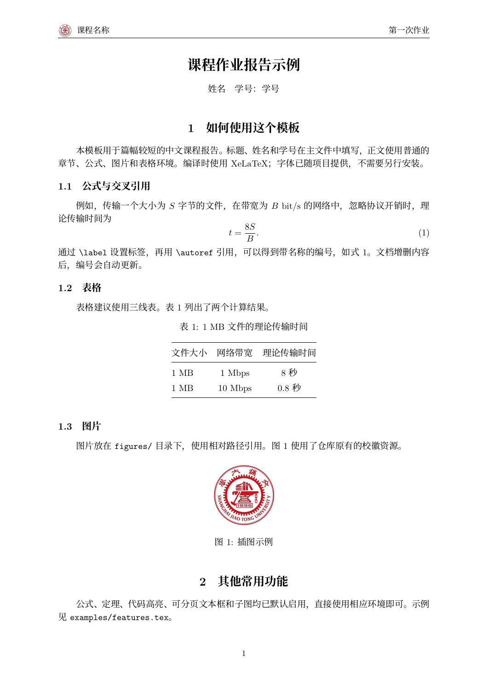

# SJTU-easylatex

简洁的中文课程作业模板：页眉小校徽、自动编号、中文字体都已配好。
**公式、定理、代码、表格、文本框和子图默认可用**，只需修改作业信息和正文。



[查看 PDF](main.pdf) · [常用功能示例](examples/features.tex)

## 使用

下载整个仓库，用 **XeLaTeX** 编译 `main.tex`。
Overleaf 用户上传整个项目后，将编译器设为 XeLaTeX。
请保留 `fonts/` 和 `figures/`，无需安装额外的中文字体。

在 `main.tex` 中填写：

```tex
\title{作业标题}
\author{姓名}
\reportsetup{
  course={课程名称},
  assignment={第一次作业},
  student-id={学号}
}
% \date{\today} % 需要日期时取消注释
```

本地编译（需要 TeX Live / MacTeX / MiKTeX 的中文支持）：

```sh
latexmk -xelatex -interaction=nonstopmode -halt-on-error -outdir="build" "main.tex"
```

PDF 位于 `build/main.pdf`。没有 latexmk 时，连续运行两次 `xelatex "main.tex"` 即可。

## 常用写法

| 内容 | 用法 |
| --- | --- |
| 公式与引用 | `equation`、`\label`、`\autoref` |
| 定理与证明 | `Theorem`、`Lemma`、`Definition`、`proof` 等环境 |
| Python 代码 | `lstlisting[language=Python]` |
| 文本框 | `\tbox{内容}` 或可跨页的 `reportbox` 环境 |
| 图片与子图 | `\includegraphics`、`subfigure` 环境 |
| 三线表 | `tabular`、`\toprule`、`\midrule`、`\bottomrule` |

完整代码见 [main.tex](main.tex) 和 [examples/features.tex](examples/features.tex)，均从仓库根目录编译。

不需要校徽时使用 `\usepackage[logo=false]{easyR}`；也可以用 `logopath={图片路径}` 更换。
其他功能保留 `code=false`、`theorems=false`、`boxes=false`、`subfigures=false` 关闭选项。
中文字体及许可证见 [fonts/README.md](fonts/README.md)。

## 检查

运行 `python3 "tests/check.py"`（需要 latexmk、XeLaTeX、pdfLaTeX 和 Poppler 的 `pdftotext`）。
GitHub Actions 会自动检查编译、中文提取和引用等。编译中间文件放在 `build/`，不提交到仓库。
